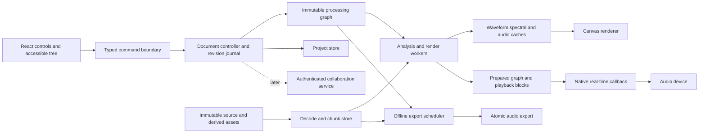

# Tonalia technical architecture

**Status: proposed architecture; feasibility and dependency qualification follow approval.**

## Architecture decision

Use a portable Rust processing core and native audio I/O for the first professional editor. React and TypeScript own controls and accessible document navigation. A dedicated renderer owns the high-frequency canvas loop. Keep expensive decoding, analysis, resynthesis and repair outside the UI thread and the device callback.

### Options considered

| Option | Advantages | Costs and limitations | Recommendation |
| --- | --- | --- | --- |
| Browser React + Web Audio + WASM | Accessible sharing, rapid UI delivery, portable kernels | Browser storage/lifecycle, hardware routing, device-rate behavior, codec differences and memory limits require qualification | Later browser viewer/reviewer and selected editing capabilities |
| Tauri + React + native Rust | Fits a Rust core; system integration; small shell | System WebView/graphics differences and IPC require real-platform testing | First shell candidate |
| Electron + React + native Rust sidecar | Bundled Chromium gives a more controlled renderer runtime | Larger bundle/memory; native sidecar distribution and additional security maintenance | Fallback if Tauri fails defined compatibility gates |
| JUCE/C++ native | Mature audio/device/plugin abstractions and native drawing | C++ ownership burden; UI/web collaboration requires more custom work; licence decision | Viable alternative if plugin hosting becomes the main product |
| Fully native Rust UI + wgpu | Direct native rendering/engine control | Desktop accessibility, rich editing controls and browser sharing need additional evaluation | Reconsider only if web-shell overhead blocks measured targets |

Tauri uses a system WebView; its version depends on the platform runtime. Electron embeds Chromium and separates main/renderer processes. These facts support a conditional shell choice, not a blanket speed comparison. [Tauri architecture](https://tauri.app/concept/architecture/), [WebView versions](https://tauri.app/reference/webview-versions/), [Electron process model](https://www.electronjs.org/docs/latest/tutorial/process-model)

P0 qualification must cover WebGPU detection, WebGL2 fallback, high-DPI pointer mapping, binary tile throughput, keyboard/accessibility, installers, memory and long-running playback on each proposed platform. Prefer Tauri if these pass. Otherwise select Electron and retain the same engine/document/render interfaces. Do not build two production shells simultaneously.

## Logical components and data flow

The graph is authoritative for sound; the journal/document is authoritative for user intent; caches are never the only copy of accepted work. GPU textures are visualization only.

## Proposed code organization

This is a future directory design, not application scaffolding created during planning.

| Area | Responsibility |
| --- | --- |
| `apps/desktop` | Chosen shell, signing, menu/device/file adapters |
| `packages/ui` | React controls, accessible layer tree, inspector, command palette |
| `packages/canvas` | View transforms, gestures, hit-testing, GPU/fallback adapters |
| `packages/protocol` | Generated TypeScript/Rust command/event schema and compatibility fixtures |
| `crates/tonalia-core` | Units, IDs, source mappings, masks, graph validation |
| `crates/tonalia-dsp` | STFT/iSTFT, filters, restoration and numerical contracts |
| `crates/tonalia-engine` | Scheduler, graph preparation, playback and export orchestration |
| `crates/tonalia-media` | Decode/encode, metadata, content hashing, streaming chunks |
| `crates/tonalia-project` | Persistence, journal, migrations, recovery and snapshots |
| `crates/tonalia-audio` | CPAL/platform adapters and device clock reporting |
| `crates/tonalia-wasm` | Restricted portable kernels; no native filesystem/device assumptions |
| `services/collaboration` | Later authorized metadata sync and revision service |
| `research`, `fixtures`, `benchmarks` | Independent references, licensed corpus manifests and repeatable evidence |

Use one repository and clear module boundaries. Pin the toolchains and dependencies selected during P0; do not treat changing `latest` docs as a lockfile. Rust types define units and checked sample arithmetic. Generate protocol bindings and validate versioned messages at runtime. Transport sample indices as decimal strings or safe binary integers across JS boundaries; do not lose precision through unrestricted JavaScript numbers.

## Thread and process model

| Execution context | May do | Must not do |
| --- | --- | --- |
| UI main thread | DOM, menus, accessibility, modest state updates | Decode long files, full STFT, repair, blocking native calls |
| Canvas frame loop/worker | View transforms, tile selection, overlays and draws | Run authoritative export or schedule device audio |
| Document/control worker | Validate commands, create revisions, schedule work | Block device callback on transaction completion |
| Decode/I/O pool | File reads, decode, metadata, chunk verification | Take unbounded memory or starve playback prefetch |
| DSP worker pool | Analysis, prepared graph rendering, expensive repairs | Compete without priority limits against playback preparation |
| Real-time audio thread | Bounded processing over preallocated memory, ring reads, clock counters | Allocate/free, locks, filesystem, network, logging, IPC, GPU waits, async runtimes |
| Export scheduler | Snapshot graph, render complete output, encode/write temp file | Mutate the open graph or silently omit an unavailable processor |
| Optional isolated child | Third-party plugins/model inference | Access unrelated files or publish output without authorization |

For live lightweight effects, prepare coefficients/buffers off-thread and atomically switch graph handles at a block boundary. Reclaim old graph memory off the callback; reference-count destruction on the audio thread can allocate/free and is not automatically real-time safe. Queue parameter ramps as fixed-size commands. Metering writes to bounded buffers; UI polls/downsamples at 20–60 Hz.

Heavy spectral chains pre-render ahead into bounded playback rings. If workers miss a deadline, expose an underrun and stop or fade according to policy; never substitute unprocessed audio as if the repair were present. A graph change becomes audible only when a complete aligned segment is ready. Disk underruns, device loss and CPU saturation produce distinct diagnostic states.

CPAL provides cross-platform device/stream abstractions, including platform-specific backend options. Qualification must test actual buffer negotiation, channel layouts, clocks and errors; backend availability alone does not establish professional latency. [CPAL](https://github.com/RustAudio/cpal)

## Media, precision, and timeline

- Keep source bytes and original sample rate/channel metadata immutable and hashed.
- Decode to seekable planar chunks. Use f32 processing initially for sources representable without losing decoded precision; use an f64 path for 32-bit integer preservation and reference-quality qualification. Never claim a fully f64 pipeline if a processor is f32-only.
- Use f64 for critical statistics, accumulated power, normalization and reference calculations; benchmark the cost of wider FFT processing separately.
- Choose a project timeline rate on project creation, defaulting to the first source. Preserve per-source sample coordinates. Cross-rate composition uses explicit, versioned resampling nodes and rational mappings; single-source edits stay at source rate.
- Use signed 64-bit source sample indices with checked conversions, half-open intervals `[start,end)`, and explicit channel layouts. Never use floating-point seconds as the sole persistent address.
- Respect float headroom internally. Detect nonfinite input at decode/processor boundaries and apply a documented reject/sanitize policy; do not silently clip finite float values to ±1.
- Export conversion is distinct from monitoring conversion. Device-rate resampling cannot change an export at source/project rate.

## DSP graph contract

Every node declares processor ID/version, precision support, parameters, input revision, latency, context/lookahead/tail, channels, sample-rate constraints, deterministic seed, state serialization or reset rules, and supported execution modes. Reject cycles and invalid channel/rate connections. Freeze incomplete/unsupported nodes only through explicit accepted audio assets.

For stateful processing, a seek restores a compatible checkpoint and warms up from a defined earlier boundary; arbitrary block starts must not reset noise estimates or filters. Cache keys include source/decoded-content hash, ordered upstream graph hash, processor/configuration versions, rate/channels, precision, mask hash, context, seed and render-quality tier. Meters and spectrograms identify the graph boundary they analyze.

A render result includes its dependency hash. A stale job may finish, but cannot overwrite the cache entry or ready state for a newer revision. Downstream invalidation follows graph dependencies and context support; a whole-file adaptive estimator may invalidate far more than the drawn mask.

## Spectral visualization and scaling

Stream STFT tiles and waveform peak pyramids; never construct a whole-file JavaScript `AudioBuffer` for long recordings. Preserve time-domain PCM independently of display spectra. Keep fine complex coefficients only where processing needs them; display caches may hold magnitude/power reductions and quantized GPU textures.

Use multiresolution **analysis** grids for different time/frequency detail, plus **display** level-of-detail reductions within each grid. Averaging a coarse spectrogram cannot recover fine frequency resolution. Preserve max-power information for transient visibility and mean-power information for calibrated averages; label the aggregation mode. Do not average dB values and call them physical average power.

At 48 kHz stereo, one hour of f32 PCM requires `48000 × 3600 × 2 × 4 = 1.3824 GB` (~1.29 GiB). At N=2048/H=512, one-sided complex f32 STFT storage is approximately `337500 × 1025 × 2 × 8 = 5.535 GB` (~5.15 GiB), before metadata or multiresolution copies. Therefore use chunks, disk caches, visible-region scheduling and an LRU GPU atlas. These are storage estimates, not performance measurements.

Propose 256-time-column × 256-frequency-bin tiles; choose 16-bit display encoding only after verifying precision and useful dB range. Rendering keys include analysis config and aggregation, while color palette and contrast are shader uniforms. Keep geometry overlays separate from spectral texture uploads. Cancel stale viewport jobs and prefetch a small margin along navigation direction.

[WebGPU](https://www.w3.org/TR/webgpu/) defines GPU pipelines and compute facilities; it does not guarantee availability in every target WebView. Capability-detect at runtime, record adapter limits, handle device loss, and use the same coordinate/mask tests on all rendering backends. Begin with CPU STFT plus GPU display; qualify GPU analysis only after CPU/GPU agreement and throughput measurement. No GPU readback belongs in the device callback.

## Native/UI boundary

Use typed small commands for control, compact binary transfer for tiles, and bounded event streams for progress/meters. Do not send raw PCM through JSON or one IPC call per FFT column. The first implementation may copy bounded visible tile buffers; optimize only after measuring throughput. Define explicit buffer ownership, request IDs, cancellation, revision IDs and byte budgets. Shared native/WebView memory is not presumed to be portable or zero-copy.

Persist graph/document state in the native controller. React stores UI state and subscribes to snapshots; gesture handlers update a small interaction store, with one semantic commit at gesture completion. Stop/pause must remain reachable while analysis, network or export is busy.

## Browser/WASM path

Compile pure kernels against explicit memory and I/O adapters. AudioWorklet handles bounded audio processing; workers decode/analyze/render. Inspect actual block lengths rather than hard-coding a 128-frame callback assumption: Web Audio 1.0 defines 128-frame render quanta, while 1.1 introduces configurable render-size behavior. Browser support must be measured independently. [Web Audio 1.0](https://www.w3.org/TR/webaudio-1.0/), [Web Audio 1.1](https://www.w3.org/TR/webaudio-1.1/)

Initialize WASM and allocate buffers before playback. SharedArrayBuffer/WASM threads require appropriate cross-origin isolation in the browser; supply a transferable-buffer fallback and explicit reduced capabilities. Browser storage quota, eviction, tab suspension and file permissions preclude promising desktop-equivalent long-form reliability without additional qualification. Native and WASM implementations use the same vectors with declared floating-point tolerances. [Rust WASM target](https://doc.rust-lang.org/rustc/platform-support/wasm32-unknown-unknown.html), [cross-origin isolation](https://web.dev/articles/coop-coep)

## Dependency shortlist and qualification

| Candidate | Intended role | Required qualification |
| --- | --- | --- |
| RustFFT / realfft | CPU transform kernels | Normalization, f32/f64, scratch allocation, SIMD portability, licence and reproducible vectors |
| CPAL | Native device I/O | Actual WASAPI/ASIO/CoreAudio behavior, driver SDK terms, xrun and reconnect tests |
| Symphonia | Demux/decode | Supported format/profile table, metadata, seek accuracy, malformed-file fuzzing; MPL-2.0 obligations reviewed |
| rubato | Sample-rate conversion | Sinc/FFT modes, delay/tail, stopband, preallocated APIs and rate changes |
| wgpu / WebGPU / WebGL2 | Optional native or WebView graphics | Choose one integration path initially; no duplicate renderer architecture without need |
| SQLite | Local transactional project metadata | Crash durability on target filesystem, schema migration, backup and sync-folder behavior |
| Yjs or Yrs | Later collaboration document layer | Schema/security/concurrency tests, interop, scoped undo and tombstone/size growth |

RustFFT documents accelerated paths, including WASM SIMD; rubato distinguishes quality/performance tradeoffs of resampling methods; Symphonia is a decoder rather than an all-purpose encoder. These are candidates, not selected dependency versions or verified quality guarantees. [RustFFT](https://docs.rs/rustfft/latest/rustfft/), [rubato](https://docs.rs/rubato/latest/rubato/), [Symphonia](https://github.com/pdeljanov/Symphonia)

Avoid defaulting to FFmpeg, JUCE, proprietary time-stretch SDKs or a Python backend without a concrete capability/licensing reason. Python/SciPy belongs in independent research and test oracles, not in the real-time production audio path.
